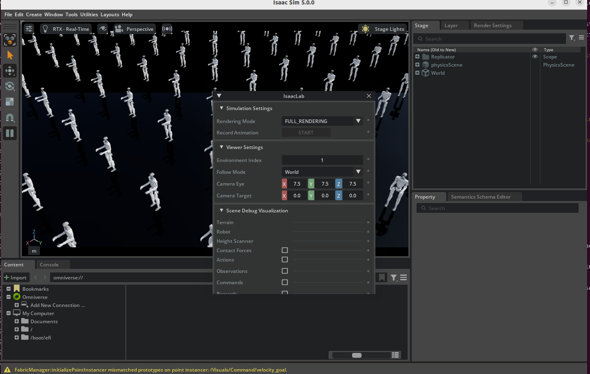
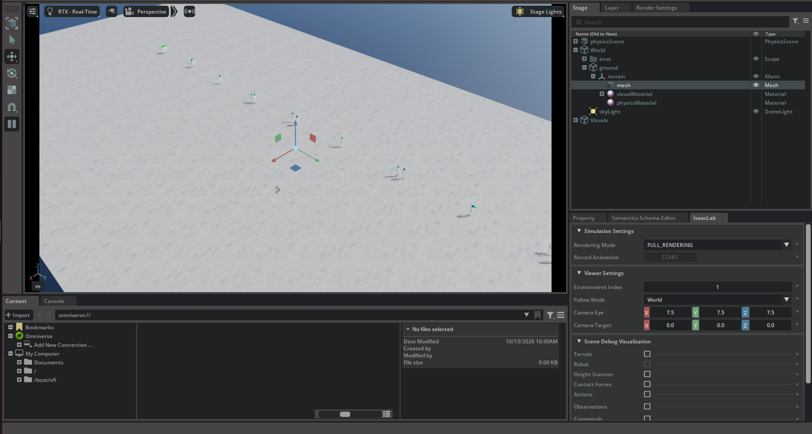
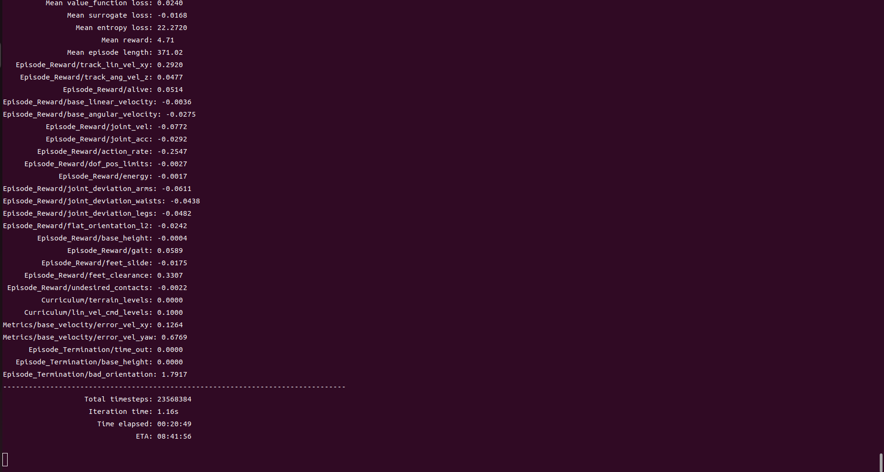
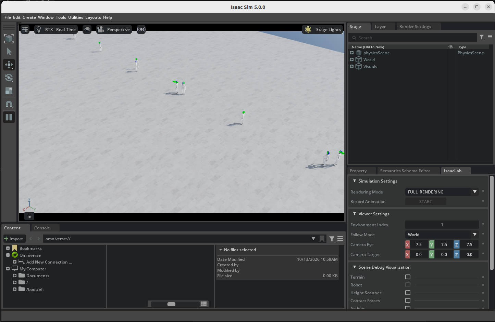
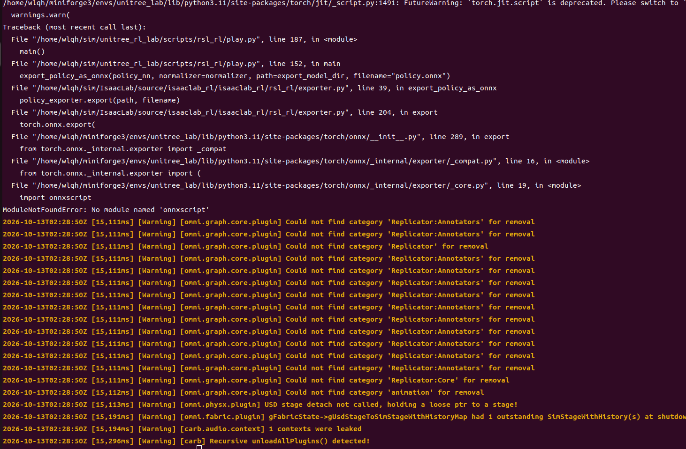
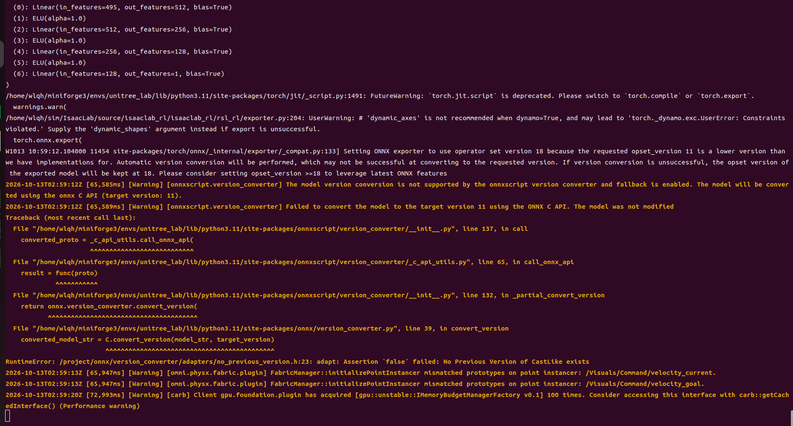
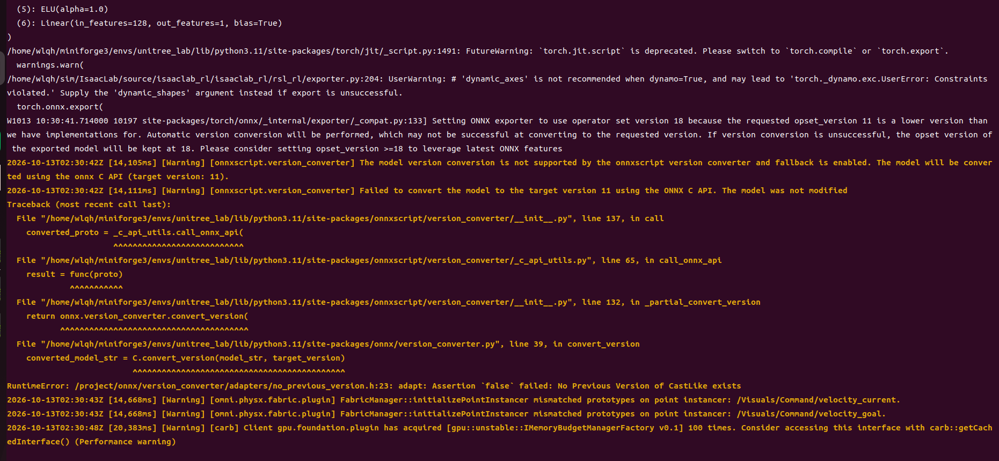
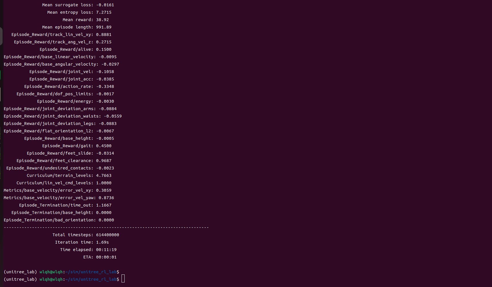

# Unitree G1 人形机器人速度追踪仿真训练

## 项目简介

本项目在 Ubuntu 22.04 + NVIDIA RTX 4090（24GB）上，基于 Isaac Sim 5.1.0、Isaac Lab 2.2.0 与 Unitree RL Lab 0.2.1，从零搭建仿真环境，训练 Unitree G1 29DOF 人形机器人完成速度追踪（Velocity Tracking）任务。训练使用 512 个并行环境、约 1600 万步，最终 Mean reward 达到约 4.69，并稳定产出 `model_0.pt` 至 `model_3000.pt` 的 checkpoint。

## 技术栈

- 操作系统：Ubuntu 22.04
- 硬件：NVIDIA RTX 4090（24GB）
- 驱动：NVIDIA 580.178.04（由 595 降级而来）
- 运行环境：Conda `unitree_lab`（Python 3.11）
- 核心框架：Isaac Sim 5.1.0、Isaac Lab 2.2.0、Unitree RL Lab 0.2.1
- 机器人模型：Unitree G1 29DOF（URDF）

## 环境搭建流程

1. 安装 NVIDIA 驱动 580.178.04（由 595 降级，避免 Isaac Sim 出现 `libcarb.tasking.plugin.so` 段错误）。
2. 创建并激活 Conda 环境：

   ```bash
   conda create -n unitree_lab python=3.11 -y
   conda activate unitree_lab
   ```

3. 安装 Isaac Sim 5.1.0（按对应版本的 pip 方式安装）。
4. 安装 Isaac Lab 2.2.0（克隆 IsaacLab 仓库后按官方安装脚本安装）。
5. 安装 Unitree RL Lab 0.2.1：

   ```bash
   git clone https://github.com/unitreerobotics/unitree_rl_lab.git
   cd unitree_rl_lab
   pip install -e .
   ```

6. 处理 Python 3.11 下 `flatdict` 等老旧依赖因 `pkg_resources` 缺失导致的构建失败：降级 setuptools，并在安装时加 `--no-build-isolation`。

## 关键配置修改

- **UNITREE_ROS_DIR**：将该配置指向 `unitree_ros` 仓库路径，使 Unitree RL Lab 能正确加载 G1 的 URDF 与 mesh 资源。
- **USD 切换为 URDF**：`unitree_ros` 仓库只提供 URDF 与 mesh、没有 USD 资产，因此在 `unitree.py` 中将 G1 29DOF 资产由 USD 改为 `UnitreeUrdfFileCfg` 加载。

## 训练命令

```bash
# 官方启动脚本（内部写死了 --headless，默认无头训练）
./unitree_rl_lab.sh -t Unitree-G1-29dof-Velocity

# 需要可视化时，训练完成后用 Play 模式回放；或直接调用 train.py 规避脚本写死的参数
```

关键训练参数：

- `num_envs = 512`：并行训练环境数
- 训练总步数约 1600 万步（Total timesteps）
- 单轮迭代约 0.59 秒
- 训练期间 GPU 显存约 8–10GB

## 训练结果

- 环境数 `num_envs`：512
- 训练总步数：约 1600 万步
- 最终 Mean reward：约 4.69
- 单轮迭代时间：约 0.59 秒
- checkpoint：`model_0.pt` 至 `model_3000.pt`
- GPU 显存占用：约 8–10GB

## 运行效果展示



训练启动/过程终端日志。



Isaac Sim GUI 中 Unitree G1 跑动画面。



nvidia-smi 显卡监控（显存约 8–10GB）。



Play 模式下的训练策略可视化回放。



训练过程中的奖励/指标表格。



训练结束时的终端日志（最终结果）。



训练结束时的终端日志（checkpoint 信息）。



训练结束后的 GPU 监控。

## 踩坑与解决方案

| 问题 | 原因 | 解决方案 |
| :--- | :--- | :--- |
| Isaac Sim 启动报 `libcarb.tasking.plugin.so` 段错误 | 595 系列驱动与 Isaac Sim 底层库不兼容 | 降级到 580 驱动 |
| `flatdict` 安装失败，报 `No module named 'pkg_resources'` | 新版 setuptools 移除该模块，pip 构建隔离 | 降级 setuptools + `--no-build-isolation` |
| `unitree_rl_lab.sh -t` 默认带 `--headless`，无法看到 GUI | 脚本内部写死 | 直接调用 train.py 或使用 Play 模式 |
| 有头模式训练时 GUI 卡死、弹无响应 | GUI 与并行环境初始化争抢主线程 | 改为无头训练 + Play 模式回放 |
| Play 模式报 `No module named 'onnxscript'` | PyTorch 2.7 ONNX 导出依赖 | `pip install onnxscript` |
| `unitree_ros` 无 USD 资产 | 仓库仅提供 URDF 和 mesh | 修改 `unitree.py` 使用 `UnitreeUrdfFileCfg` |

## 项目收获与总结

这次从零跑通 G1 速度追踪训练，最大的收获不是调参，而是把整条仿真工具链的坑都踩了一遍：驱动版本、Python 依赖隔离、资产格式（USD/URDF）、无头训练与可视化的取舍。核心教训是「环境问题往往先于算法问题出现」——先把驱动和依赖对齐官方版本，再谈训练。最终在 512 个环境下、约 1600 万步收敛到 Mean reward 约 4.69，说明 Unitree RL Lab + Isaac Lab 这条路线可行，也为后续接入真机或迁移到更复杂任务打下了基础。

## 参考链接

- Unitree RL Lab: https://github.com/unitreerobotics/unitree_rl_lab
- Isaac Lab: https://github.com/isaac-sim/IsaacLab
